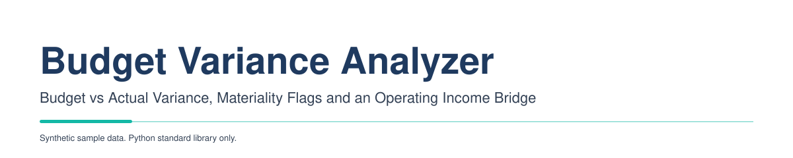
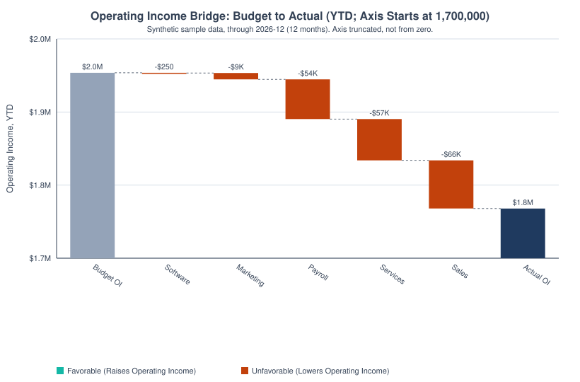
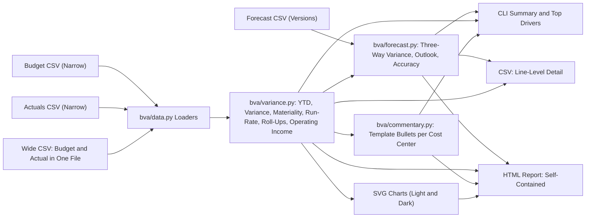
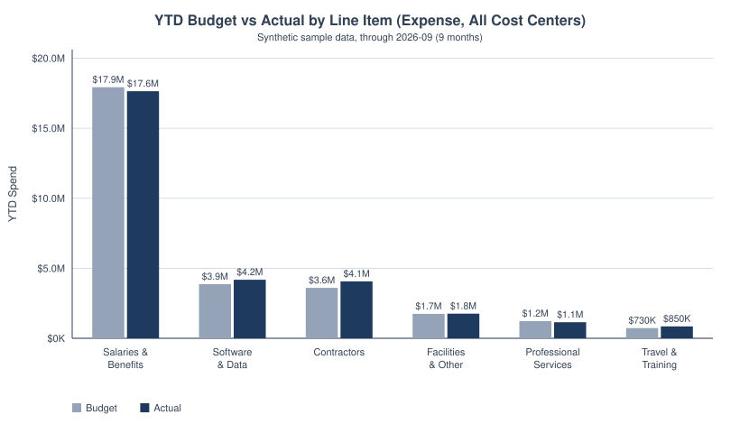
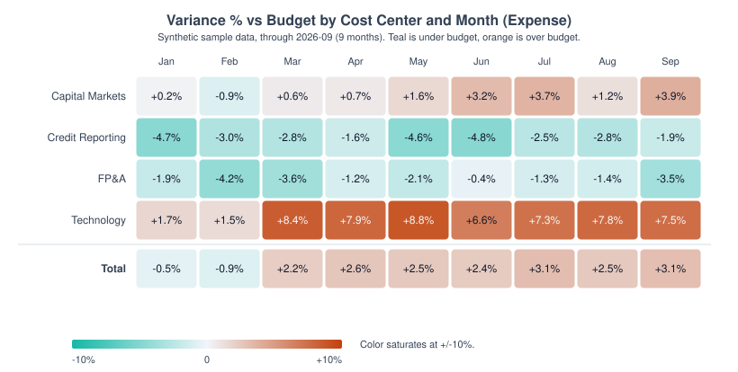
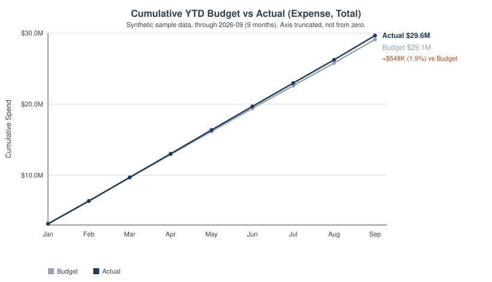
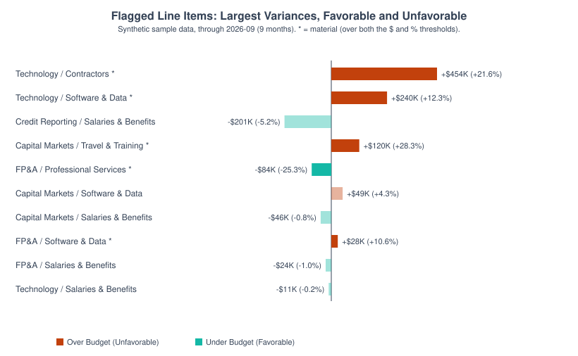
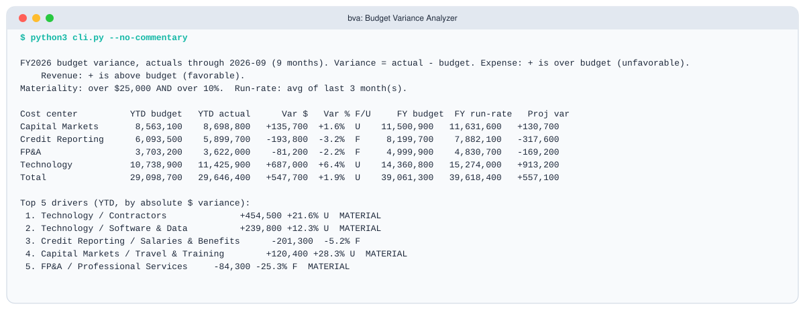
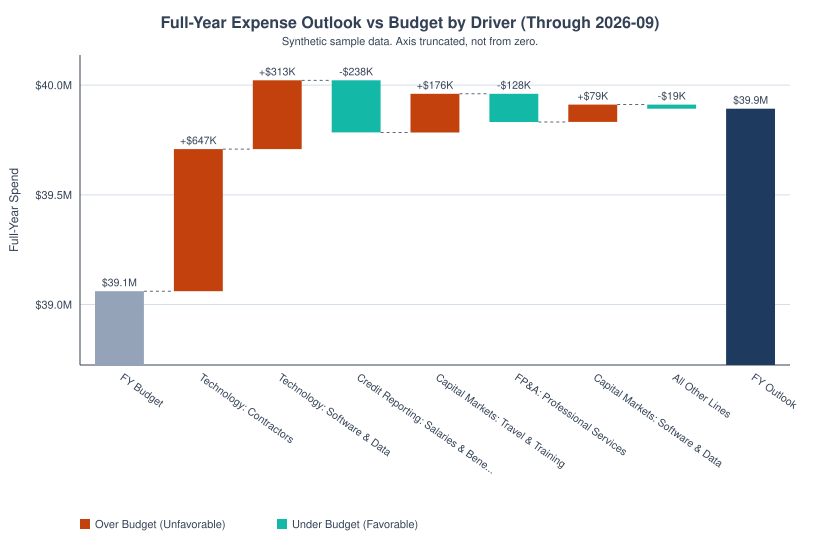
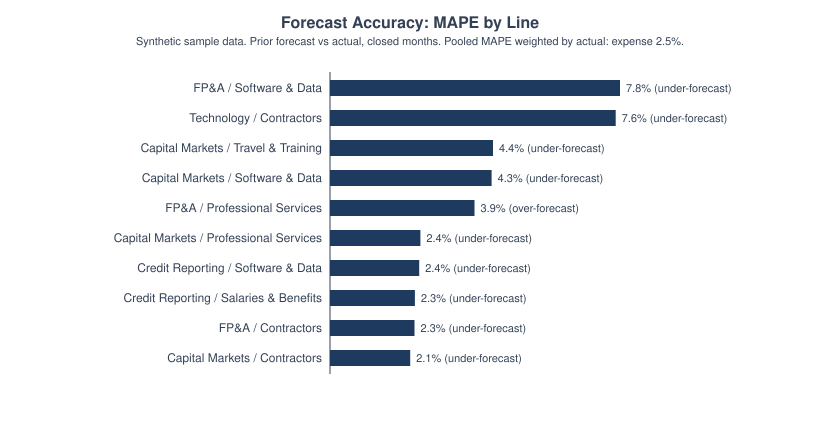

<p align="center">
  <picture>
    <source media="(prefers-color-scheme: dark)" srcset="docs/banner-dark.svg">
    
  </picture>
</p>

**For an FP&A team:** turn budget and actuals CSVs into the month-end variance pack in one command.
It flags the lines that matter, drafts the commentary, and bridges budget to actual operating income.

<picture>
  <source media="(prefers-color-scheme: dark)" srcset="docs/bridge-dark.svg">
  
</picture>

*Operating income bridge, YTD budget to actual by category, from `data/sample_wide.csv` (synthetic, revenue and expense lines, actuals through 2026-12). The steps sum exactly to the favorable variance. The axis is truncated and says where it starts.*

  

A small, dependency-free Python tool that compares budget to actuals by cost
center, account category, and month, for expense and revenue lines. It produces
what an FP&A analyst hands to a finance leader: variance in dollars and percent,
favorable or unfavorable, materiality flags, a ranked list of drivers, YTD
versus full-year, a simple run-rate projection, plain-English commentary for each
cost center, and an operating-income total with a bridge from budget to actual.
Output is a CLI summary, a CSV, and a static self-contained HTML report with
inline SVG charts.

Standard library only (Python 3.9+). No `pip install` needed.

> **Synthetic data.** Every number in this README comes from the invented sample
> data in `data/`. It is not any real company's financials.

## Contents

- [Results at a Glance](#results-at-a-glance)
- [How It Works](#how-it-works)
- [Quickstart](#quickstart)
- [Charts](#charts)
- [Sample Output](#sample-output)
- [Methodology](#methodology)
- [Rolling Forecast](#rolling-forecast)
- [Optional: Matplotlib Plots](#optional-matplotlib-plots)
- [Skills Shown](#skills-shown)
- [Limitations](#limitations)
- [Project Layout](#project-layout)
- [Data Sources](#data-sources)
- [License](#license)
- [Glossary](#glossary)

## Results at a Glance

| Measure | Result | Source |
|---|---|---|
| Expense, YTD Through 2026-09 | Actual 29,646,400 vs budget 29,098,700: +547,700 (+1.9%), unfavorable | `data/budget.csv`, `data/actuals.csv` |
| Expense, Full-Year Run-Rate | 39,618,400 projected vs 39,061,300 budget: +557,100 (+1.4%), unfavorable | same |
| Material Expense Lines | 5 of 24 lines breach both the $25,000 and 10% tests | same |
| Biggest Single Driver | Technology / Contractors: +454,500 (+21.6%), unfavorable, material | same |
| Operating Income, YTD | Budget 1,953,600 vs actual 1,767,946: -185,654 (-2.7% of gross budget 6,758,400), unfavorable | `data/sample_wide.csv` (actuals through 2026-12) |

All figures are synthetic sample data, not a real company's financials.

## How It Works

Month-end variance work is repetitive: pull budget and actuals, compute the
differences, decide which ones deserve a sentence, and write that sentence.
The slow part is judgment about what matters, not arithmetic, so this project
encodes that judgment as explicit, testable rules (a materiality test, a driver
ranking, a commentary template) that an analyst can review and override. It shares
a pattern with my covered-call screener: reduce a large table to the few rows
that matter, show the assumptions, and flag what needs a second look before
anyone acts on it.



What it does:

- Loads budget and actuals CSVs in either layout (see Input Formats). The layout
  is detected from the header.
- Accepts an optional `type` column on each line: `expense` (the default) or
  `revenue`.
- Computes YTD budget vs actual through the last closed month, and full-year
  budget.
- Variance $ and %, with favorable/unfavorable flags. Expense and revenue use
  opposite sign logic (see Sign Convention).
- Materiality flags at line level (cost center x category).
- Ranks top drivers by absolute dollar variance.
- Operating income total (revenue minus expense): budget, actual, and favorable
  variance.
- Projects the full year with a simple run-rate and compares it to budget.
- Writes template-based commentary bullets per cost center (expense lines).
- With a forecast file: actual vs forecast, forecast vs budget for open months, a
  full-year outlook (YTD actuals plus forecast), forecast accuracy (MAPE and bias),
  and one-line commentary drafts for material lines. See Rolling Forecast.
- Writes a line-level CSV, an HTML report, and SVG charts.

## Quickstart

Copy-paste first run (no install, uses the bundled synthetic data):

```bash
python3 cli.py
```

More:

```bash
python3 cli.py                                          # bundled synthetic data, summary + commentary
python3 cli.py --budget data/sample_wide.csv            # wide layout with revenue and expense lines
python3 cli.py --through 2026-06 --top 8                # as of an earlier close
python3 cli.py --fail-on-material                       # exit 1 if any line is material (scripts, CI)
python3 cli.py --projection budget-remaining            # full year = YTD actual + remaining budget
python3 cli.py --allow-missing-actuals                  # count closed months with no actuals as $0 instead of failing
python3 cli.py --json                                   # machine-readable analysis on stdout
python3 cli.py --forecast data/forecast.csv             # rolling forecast: outlook, accuracy, commentary drafts
python3 cli.py --forecast data/forecast.csv --forecast-csv output/outlook.csv --accuracy-csv output/accuracy.csv
python3 cli.py --pvm data/pvm_example.csv               # revenue price / volume / mix split
python3 cli.py --amount-threshold 50000 --pct-threshold 5 --run-rate-months 6
python3 cli.py --csv output/variance_detail.csv --html output/report.html --charts output/charts
python3 cli.py --xlsx output/variance.xlsx                # Excel: blue inputs, live variance, materiality and subtotal formulas
python3 cli.py --budget my_budget.csv --actuals my_actuals.csv   # your own files (placeholder names)
python3 -m unittest discover -v                         # run the tests
python3 -m bva.charts                                   # regenerate every SVG in docs/ (light and dark)
python3 data/generate_sample.py                         # regenerate the synthetic data
python3 plots_mpl.py                                    # optional PNGs in docs/mpl (needs matplotlib)
```

Use `python3 cli.py -h` for all options. `--through` defaults to the latest
month present in the actuals. Materiality thresholds are `--amount-threshold`
(dollars, default 25000) and `--pct-threshold` (percent, default 10); a line must
be strictly above both to be flagged.

Two sample reports are in `docs/` (open them in a browser): `sample_report.html`
(expense-only data, with the Rolling Forecast section from `data/forecast.csv`) and `sample_report_wide.html` (revenue and expense, with the
operating-income section and bridge).

### Input Formats

Narrow (one file for budget, one for actuals):

```
cost_center,category,month,amount[,type]
```

Amounts may use commas, a dollar sign, or accounting negatives such as `(1,200)`. `nan` and `inf` are rejected.

Wide (one file with both budget and actual):

```
month,department,line_item,type,budget,actual
```

- In the wide layout the department is the cost center and the line item is the
  category. It is detected when the header has `budget` and `actual` columns,
  and then no separate actuals file is needed.
- A blank `actual` cell marks a month that has not closed, so a wide file can carry the
  full-year budget. A blank inside a closed month is still an error.
- `type` is case-insensitive and must be `expense` or `revenue`. A missing
  `type` column means expense. Any other value raises an error that names the row.
- A line cannot be revenue in one row and expense in another. That raises an error too.
- Lines starting with `#` are comments. Duplicate keys are summed.

Forecast (a third file, `--forecast`):

```
cost_center,category,month,amount[,as_of]
```

- `as_of` (YYYY-MM) is the last closed month when that forecast version was made, so a
  version made after the March close has `as_of` 2026-03 and covers April onward. A row
  must be for a month after its `as_of`. Several versions of the same month can sit in one file.
- Without an `as_of` column the file is treated as one latest version: the outlook works,
  but accuracy cannot be measured.
- The lines match the budget file by cost center and category. With a wide budget file, use
  its department and line item names.

## Charts

All charts are hand-written SVG from `bva/charts.py`, with a light and a dark
version. The line-item, heatmap, cumulative and flagged charts use the bundled
expense sample (`data/budget.csv` and `data/actuals.csv`).

**Budget vs actual by line item.** Grouped bars, YTD, summed across the four cost
centers. Salaries & Benefits is the largest line and is slightly under budget,
while Contractors and Software & Data run over.

<picture>
  <source media="(prefers-color-scheme: dark)" srcset="docs/line-items-dark.svg">
  
</picture>

**Variance % by cost center and month.** A heatmap of actual vs budget for each
cost center and each closed month, plus the expense total. Technology is over
budget in every closed month, and the color scale is symmetric around zero.

<picture>
  <source media="(prefers-color-scheme: dark)" srcset="docs/heatmap-dark.svg">
  
</picture>

**Cumulative YTD budget vs actual.** The running expense total against budget.
Actual runs slightly under budget in January and February, then above it from
March on. The end-point labels show the closing variance. The axis is truncated.

<picture>
  <source media="(prefers-color-scheme: dark)" srcset="docs/cumulative-dark.svg">
  
</picture>

**Flagged line items.** The ten largest line variances, favorable and
unfavorable. Solid bars are material (over both the dollar and percent tests),
and faded bars are not. Under budget is teal and over budget is orange.

<picture>
  <source media="(prefers-color-scheme: dark)" srcset="docs/flagged-dark.svg">
  
</picture>

## Sample Output

<picture>
  <source media="(prefers-color-scheme: dark)" srcset="docs/sample-output-dark.svg">
  
</picture>

*`python3 cli.py --no-commentary` on the bundled synthetic data. The full output, with commentary, is below.*

<details>
<summary>Full Output</summary>

```
FY2026 budget variance, actuals through 2026-09 (9 months). Variance = actual - budget. Expense: + is over budget (unfavorable). Revenue: + is above budget (favorable).
Materiality: over $25,000 AND over 10%.  Projection: run-rate, avg of last 3 month(s).

Cost center          YTD budget   YTD actual      Var $   Var % F/U     FY budget  FY run-rate   Proj var
Capital Markets       8,563,100    8,698,800   +135,700  +1.6%  U    11,500,900   11,631,600   +130,700
Credit Reporting      6,093,500    5,899,700   -193,800  -3.2%  F     8,199,700    7,882,100   -317,600
FP&A                  3,703,200    3,622,000    -81,200  -2.2%  F     4,999,900    4,830,700   -169,200
Technology           10,738,900   11,425,900   +687,000  +6.4%  U    14,360,800   15,274,000   +913,200
Total                29,098,700   29,646,400   +547,700  +1.9%  U    39,061,300   39,618,400   +557,100

Top 5 drivers (YTD, by absolute $ variance):
 1. Technology / Contractors              +454,500 +21.6% U  MATERIAL
 2. Technology / Software & Data          +239,800 +12.3% U  MATERIAL
 3. Credit Reporting / Salaries & Benefits      -201,300  -5.2% F
 4. Capital Markets / Travel & Training        +120,400 +28.3% U  MATERIAL
 5. FP&A / Professional Services     -84,300 -25.3% F  MATERIAL

Commentary:
 Capital Markets
  - YTD Jan-Sep spend $8.70M vs budget $8.56M: $136K (1.6%) over budget, unfavorable.
  - Largest driver: Travel & Training, $120K (28.3%) over budget, unfavorable (material).
  - Also: Software & Data, $49K (4.3%) over budget, unfavorable.
  - Also: Salaries & Benefits, $46K (0.8%) under budget, favorable.
  - Material items (over $25K and 10%): Travel & Training.
  - Run-rate (last 3 months average) projects full year at $11.63M vs budget $11.50M: $131K (1.1%) over budget, unfavorable.
 Credit Reporting
  - YTD Jan-Sep spend $5.90M vs budget $6.09M: $194K (3.2%) under budget, favorable.
  - Largest driver: Salaries & Benefits, $201K (5.2%) under budget, favorable.
  - No line breaches the materiality test (over $25K and 10%).
  - Run-rate (last 3 months average) projects full year at $7.88M vs budget $8.20M: $318K (3.9%) under budget, favorable.
 FP&A
  - YTD Jan-Sep spend $3.62M vs budget $3.70M: $81K (2.2%) under budget, favorable.
  - Largest driver: Professional Services, $84K (25.3%) under budget, favorable (material).
  - Also: Software & Data, $28K (10.6%) over budget, unfavorable (material).
  - Material items (over $25K and 10%): Professional Services, Software & Data.
  - Run-rate (last 3 months average) projects full year at $4.83M vs budget $5.00M: $169K (3.4%) under budget, favorable.
 Technology
  - YTD Jan-Sep spend $11.43M vs budget $10.74M: $687K (6.4%) over budget, unfavorable.
  - Largest driver: Contractors, $454K (21.6%) over budget, unfavorable (material).
  - Also: Software & Data, $240K (12.3%) over budget, unfavorable (material).
  - Material items (over $25K and 10%): Contractors, Software & Data.
  - Run-rate (last 3 months average) projects full year at $15.27M vs budget $14.36M: $913K (6.4%) over budget, unfavorable.
```

</details>

Commentary states what moved and by how much. It deliberately does not assert a
cause; the cost-center owner supplies the why. Commentary covers expense cost centers.

The Credit Reporting salaries line is the third-largest dollar variance, but it is not
flagged material: $201K clears the dollar test, but 5.2% does not clear the percentage
test. That is the point of requiring both.

The wide sample (`python3 cli.py --budget data/sample_wide.csv --no-commentary`) has
revenue and expense lines, so it also prints the operating-income total. Operating income
fell 185,654 short of budget: two revenue lines (Sales, Services) missed and payroll ran
over.

## Methodology

Notation: `A` = YTD actual, `B` = YTD budget (same closed months only), `n` =
closed months, `m = 12 - n`.

### Sign Convention

Every line stores `actual - budget`. The F/U column tells you whether that
variance helps or hurts.

| Line Type | Positive Variance Means | Favorable When |
|---|---|---|
| `expense` | actual above budget (overspend) | variance is negative (under budget) |
| `revenue` | actual above budget (a beat) | variance is positive (above budget) |

The operating-income total is revenue minus expense, so its favorable variance
is the change in operating income. Positive always means favorable there.

### Formulas

| Item | Formula |
|---|---|
| Variance $ | `A - B`. Expense: positive = over budget = **unfavorable**. Revenue: positive = above budget = **favorable** |
| Status (F/U) | Expense: over budget is U, under is F. Revenue: above budget is F, below is U |
| Variance % | `(A - B) / abs(B)`; undefined (n/a) when `B = 0` |
| Material | `abs(A - B) > 25,000` **and** `abs(var %) > 10%` (both strict, both configurable; if `B = 0` only the $ test applies) |
| Run-rate projection | `FY_proj = A + m * avg(last k closed months of actual)`, default `k = 3` (`0` = average all YTD months) |
| Budget-remaining projection (`--projection budget-remaining`) | `FY_proj = A + sum(budget of the remaining m months)`: assumes the rest of the year lands on plan, so projected variance equals YTD variance |
| Projected variance | `FY_proj - full-year budget` |
| Top drivers | lines sorted by `abs(variance $)`, descending |
| Operating income (OI) | `OI = sum(revenue) - sum(expense)`, YTD, for budget (`OI_B`) and actual (`OI_A`) |
| OI favorable variance | `OI_A - OI_B`. Positive increases operating income |
| OI variance % | `OI favorable / G`, where `G` = sum of `abs(B)` over all lines (the gross budget). n/a when `G = 0` |

The run-rate and the operating income percentage in plain LaTeX:

$$FY_{\text{proj}} = A + m \cdot \bar{a}_k, \qquad \bar{a}_k = \frac{1}{k}\sum_{t=n-k+1}^{n} a_t$$

$$\text{OI var \%} = \frac{OI_A - OI_B}{G}, \qquad G = \sum_{\ell} \lvert B_\ell \rvert$$

Cost-center and total rows are built by summing the expense lines' monthly
series, then applying the same formulas, so every level reconciles. Revenue
lines appear as lines (in the CSV, the top drivers and the bridge) and in the
operating-income total. The expense waterfall logic (in the HTML report) starts
at YTD budget, adds each top expense driver's variance, adds an "all other
lines" step so the bars close, and ends at YTD actual.

The bridge starts at budget operating income, adds one step per category (largest
favorable step first), and ends at actual operating income. The steps sum exactly to
the operating-income variance (actual less budget); the tests check this. Its y-axis is
truncated, with the start stated in the title, and the total bars hang from the axis
floor.

### Price, Volume, Mix (`--pvm`)

Optional and separate from the line-level analysis: it needs unit quantities and prices, which the
amount CSVs do not carry. Input columns: `product, budget_qty, budget_price, actual_qty, actual_price`.
With `BQ, BP` budget and `AQ, AP` actual per product:

| Item | Formula |
|---|---|
| Price | `sum((AP - BP) * AQ)`, which is actual revenue minus the flexed budget |
| Flexed budget | `sum(AQ * BP)`: actual units at budget prices |
| Volume | `(sum(AQ) - sum(BQ)) * sum(BQ*BP) / sum(BQ)`: total unit change at the average budget price |
| Mix | `sum((AQ - sum(AQ) * BQ / sum(BQ)) * BP)`: what is left of flexed minus static budget |

Price + volume + mix equals actual minus budget revenue exactly. Volume + mix is the sales volume
variance (flexed minus static budget); price is the flexible budget variance. Positive is favorable.
`data/pvm_example.csv` is the three-product example from the Zebra BI article below: price is
46,750 and volume + mix is 11,500, matching it. The article leaves mix as a residual and its
own mix formula gives a different split, so volume and mix here follow the CMA-style definitions
(volume at the average budget price, mix against the budget mix). Conventions differ between sources;
state which one you use. Cost-side (expense) flexing is not implemented.

Sources: [Zebra BI, price volume mix analysis](https://zebrabi.com/price-volume-mix-analysis-excel/),
[Lumen Learning, sales volume variance](https://courses.lumenlearning.com/wm-managerialaccounting/?p=1098),
[Achievable CMA, flexible budget variance](https://app.achievable.me/study/cma-part-1/learn/performance-management-cost-and-variance-measures-flexible-budgets-the-flexible-budget-variance).
Projection method background: [Oracle trend methods](https://docs.oracle.com/en/cloud/saas/planning-budgeting-cloud/epbug/fin_trend_descriptions_100xa8257468.html),
[Calxa, YTD actuals plus remaining budget](https://helpme.calxa.com/en/articles/5272475-ytd-full-year-forecast-vs-approved).

**Fiscal year** is the calendar year of the last closed month.

## Rolling Forecast

Pass `--forecast` to add the forecast views. The sample is `data/forecast.csv`
(synthetic, versions as of 2026-03, 2026-06 and 2026-09).

Three views per line, using the same sign convention as above:

| View | Months | Compares |
|---|---|---|
| Actual vs budget | Closed | The existing YTD variance |
| Actual vs forecast | Closed months that had a prior forecast | Actual against the latest version made before that month |
| Forecast vs budget | Open | Latest forecast against budget for the remaining months |

**Outlook** is the standard "actuals plus forecast": `Outlook = YTD actual + latest forecast for each open month`,
compared with the full-year budget. The latest forecast for an open month is the version with the
greatest `as_of` on or before the close. Versions dated after `--through` are ignored and noted.
Total Expense and Total Revenue rows sum the lines of each type.

**Forecast accuracy** needs versions. For each closed month with a prior forecast version (the latest
version with `as_of` before that month), `error = forecast - actual`. Per line:

| Item | Formula |
|---|---|
| MAPE | mean of `abs(actual - forecast) / abs(actual)` over the months with a nonzero actual |
| Bias $ | sum of `forecast - actual`. Positive is over-forecast, negative is under-forecast |
| Bias % | bias $ / `abs(sum of actual)` |

Accuracy is also pooled at the Total Expense and Total Revenue level. **Weighted MAPE** is
`sum(abs(actual - forecast)) / sum(abs(actual))` over every line-month, so large lines count more than small
ones, and the pooled bias is the sum of `forecast - actual` over the same line-months. The same pooling by
**horizon** (months from the version's `as_of` to the month) shows whether longer-range forecasts miss more.
It appears in the CLI summary and the HTML report.

MAPE says how far off the forecast was on average, and bias says which way it leaned.
A line can have a low MAPE and a large bias if it misses the same way every month.

**Commentary drafts** are one sentence for each line that is material by the existing test, applied
to either the YTD variance or the outlook variance. Each draft gives YTD against budget, the result against
the prior forecast, and the outlook against the full-year budget, with favorable or unfavorable by line
type. They are fixed templates that state what moved, not why. The owner of the line supplies the cause.

**Charts.** The outlook chart bridges the full-year expense budget to the outlook, one step per
driver line, with the axis truncated and labeled. The accuracy chart ranks the ten worst lines by MAPE and
puts the pooled weighted MAPE in its subtitle. Both are in the HTML report's Rolling Forecast section
and regenerate with `python3 -m bva.charts`.

<picture>
  <source media="(prefers-color-scheme: dark)" srcset="docs/forecast-outlook-dark.svg">
  
</picture>

<picture>
  <source media="(prefers-color-scheme: dark)" srcset="docs/forecast-accuracy-dark.svg">
  
</picture>

**Missing data fails closed.** A line with no forecast for an open month raises an error that names the
line and month. Nothing is filled in from budget.

Output goes to the CLI summary, the HTML report (a Rolling Forecast section), and two CSVs:
`--forecast-csv` for the outlook rows and `--accuracy-csv` for MAPE and bias.

## Optional: Matplotlib Plots

The core is standard library only. `plots_mpl.py` draws Matplotlib versions of the
main charts (bridge, line items, heatmap, cumulative, flagged) as PNG files in
`docs/mpl/`.

```bash
pip install -r requirements-extra.txt
python3 plots_mpl.py
```

Without Matplotlib installed the script prints a short message and exits. None of the
core tool, the tests, or the SVG charts depend on it.

## Skills Shown

Python · FP&A variance analysis · Operating income bridge · Materiality rules · Data visualization (hand-written SVG) · Unit testing

## Limitations

- Run-rate is naive. It extends recent months flat, so it ignores
  seasonality, known one-time items, hiring plans, and contract step-ups. It
  is a sanity check against budget, not a forecast.
- Revenue is a line type, not a full P&L structure. There are no contra-revenue,
  gross-to-net, or cost-of-sales subtotals. Cost-center and total rows cover
  expense lines only.
- The price/volume/mix split covers revenue only and is a separate input file.
- The operating-income total is YTD only. It has no full-year projection.
- There is no budget phasing logic beyond what is in the file, and no prior-year comparison.
- Forecast accuracy scores each month against only the latest version made before it, so
  the horizon split shows how far ahead that version was, not how every older version did.
  Months with a zero actual are left out of MAPE.
- The forecast file is the narrow layout only.
- A closed month with no actuals for a line is an error, because a late feed would
  otherwise look like a favorable variance. `--allow-missing-actuals` counts those
  months as $0 in YTD (with a warning) and leaves them out of the run-rate average.
  Under `budget-remaining` they still add $0, so the projection is understated.
- Materiality is a fixed dollar-and-percent rule applied per line; real
  policies often vary by account or cost center.
- Commentary is template text with no causal explanation, and has no
  knowledge of accruals timing, reclasses, or allocations.
- The data is synthetic and small; no GL integration or multi-currency.
- The heatmap and cumulative charts cover expense lines only, and the operating
  income bridge covers the wide sample only.

### Next Steps

1. Headcount/rate decomposition for compensation lines, and price/volume on the line-level data.
2. Seasonal run-rate using prior-year phasing.
3. Per-category materiality thresholds from a config file.
4. Score every forecast version, not only the latest, for a full accuracy-by-horizon view.

## Project Layout

```
bva/data.py         CSV loaders: narrow and wide layouts, type column, validation
bva/variance.py     variance, materiality, YTD, run-rate, roll-ups, operating income, bridge steps, top drivers
bva/commentary.py   template-based commentary, plus forecast commentary drafts
bva/charts.py       hand-written SVG charts, light and dark: bridge, line items, heatmap, cumulative, flagged, forecast outlook and accuracy, banner, terminal output
bva/forecast.py     rolling forecast: three-way variance, outlook, accuracy (MAPE, bias)
bva/pvm.py          price / volume / mix split and flexed budget
bva/report.py       static HTML report and CSV writer
bva/xlsx.py         Excel export with live formulas, standard library only
cli.py              command line interface
plots_mpl.py        optional matplotlib PNG versions of the main charts (needs requirements-extra.txt)
requirements-extra.txt  optional dependency list (matplotlib)
data/               synthetic budget.csv, actuals.csv (narrow), forecast.csv (versions), sample_wide.csv (wide), seeded generator
docs/               README SVGs (light and dark), sample HTML reports, docs/mpl/ optional PNGs
tests/              unittest suite
```

## Data Sources

None. All data in this repository is synthetic: invented cost centers, categories,
departments, and amounts, generated by the seeded script `data/generate_sample.py`.

## License

MIT. See `LICENSE`.

## Glossary

| Term | Plain-English Meaning |
|---|---|
| Accrual | Recording a cost or sale in the month it happens, even if the bill or cash comes later, like writing down a dinner tab when you eat. |
| Actuals | What was really spent or earned, as opposed to what was planned. |
| Allocation | Splitting a shared cost, like rent for an office, among the teams that use it. |
| Bias | Whether forecasts lean high or low. Forecast minus actual, so positive means the forecast was too high. |
| Bridge (waterfall) | A step chart that starts at one total, adds or subtracts each cause, and ends at the final number, like walking up or down a staircase. |
| Budget | The plan for how much to spend or earn in a period, like a monthly spending plan. |
| Closed month | A month whose books are finished, so no more changes are expected, like a store's register closed for the night. |
| Cost center | A team or department that tracks its own spending. |
| Expense | Money spent to run the business, like salaries or software. |
| Favorable / unfavorable | Whether a variance helps profit (favorable) or hurts it (unfavorable). |
| FP&A | Financial planning and analysis: the team that sets budgets, tracks results and explains the differences. |
| Full-year budget (FY) | The whole-year plan, covering all twelve months. |
| General ledger (GL) | The master record book where every financial transaction is written down. |
| Gross budget | All budget amounts added together, ignoring plus and minus signs, used as the base for the operating income change. |
| MAPE | Mean absolute percent error: on average, how far off the forecast was, ignoring direction. |
| Materiality | A threshold for what is big enough to deserve attention; here a variance must clear both a dollar and a percent test. |
| Operating income | Money left from sales after paying the costs of running the business, before interest and taxes. |
| Outlook | Where the full year is heading: actuals so far plus the forecast for the months left. |
| Reclass | Moving a recorded amount from one account to another, like moving a receipt from the wrong folder into the right one. |
| Revenue | Money coming in from sales or services. |
| Run-rate | A projection that assumes recent months continue at the same pace, like estimating a trip's total time from your average speed. |
| Seasonality | Patterns that repeat at certain times of year, like stores selling more in December. |
| Variance | The gap between actual results and the budget. |
| YTD | Year to date: totals from January through the latest closed month. |

---

Built by Hari Saravanan · [LinkedIn](https://www.linkedin.com/in/srihari-saravanan)
