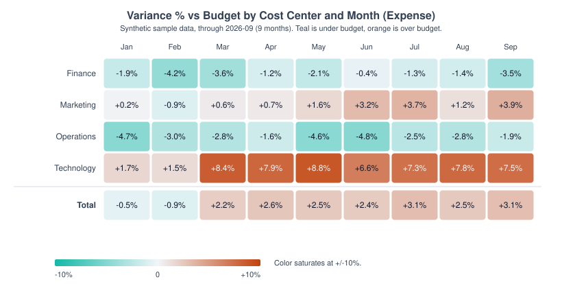
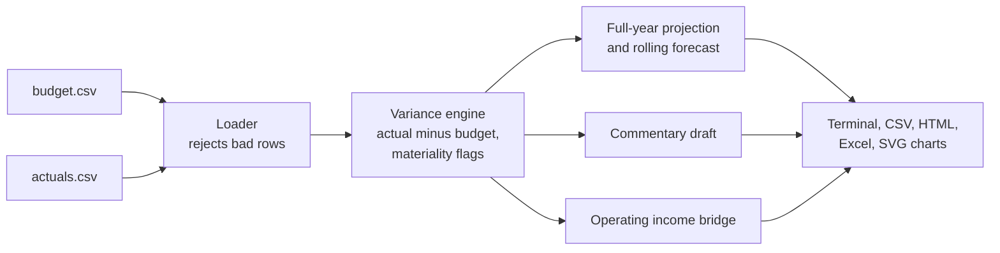
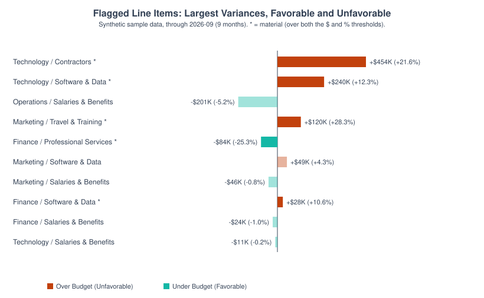
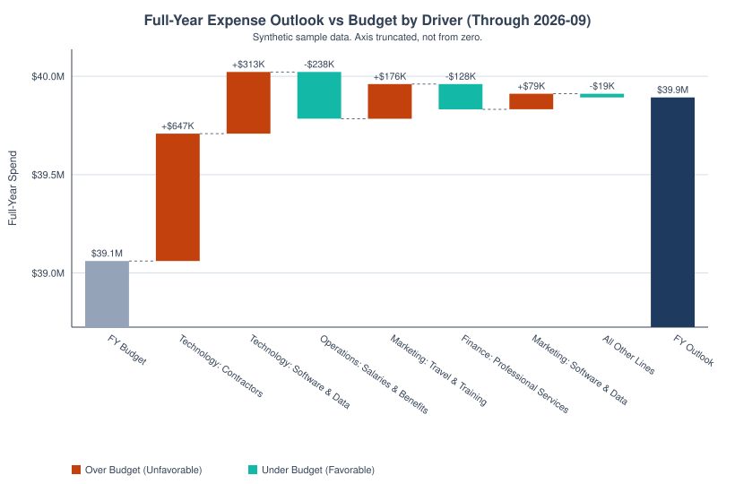
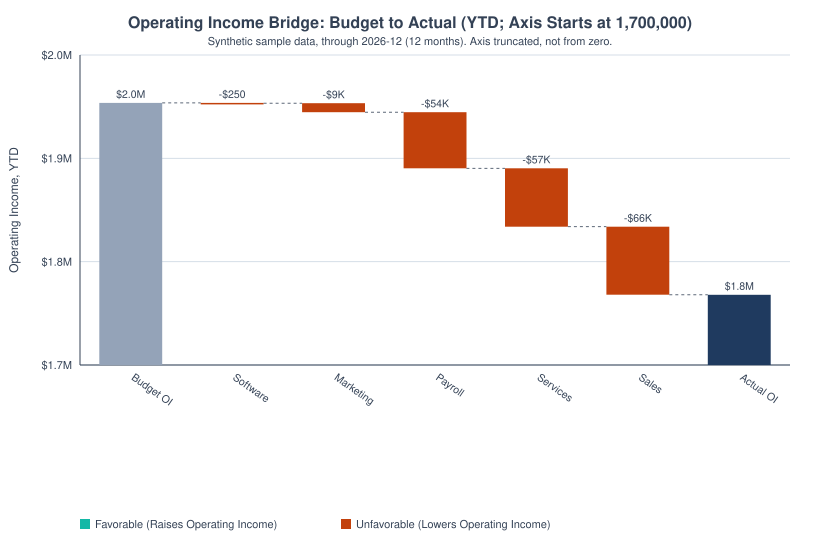
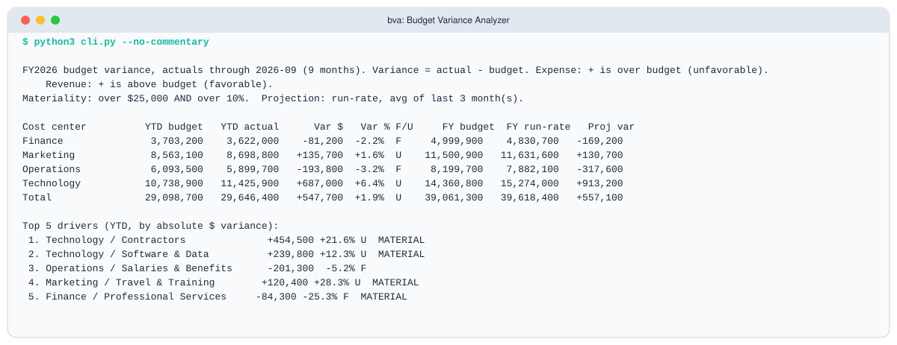
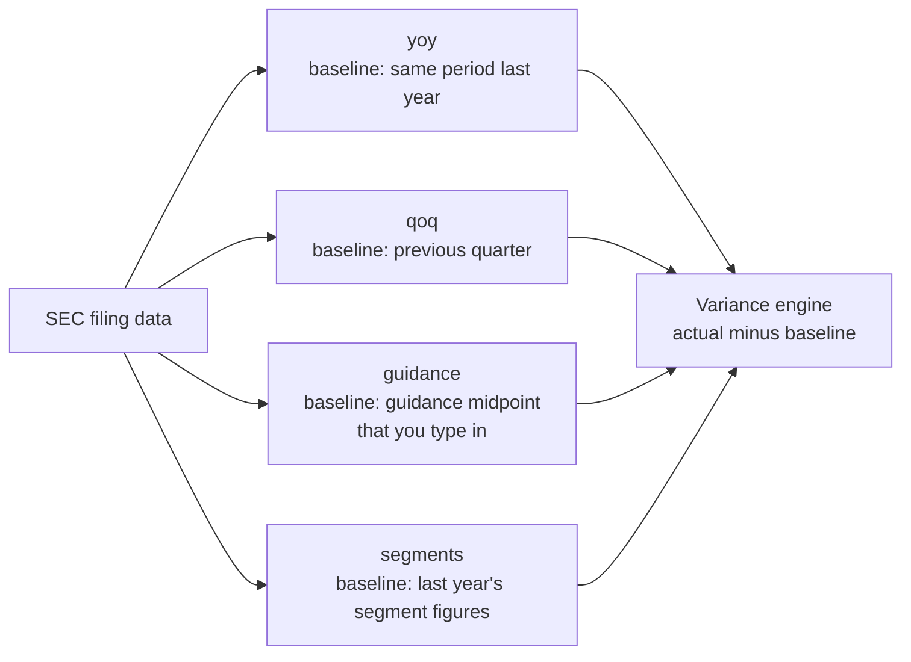
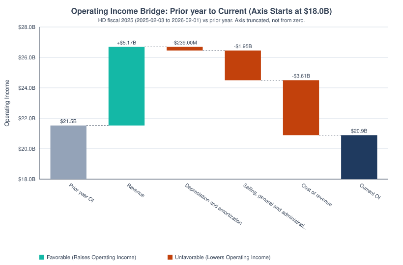
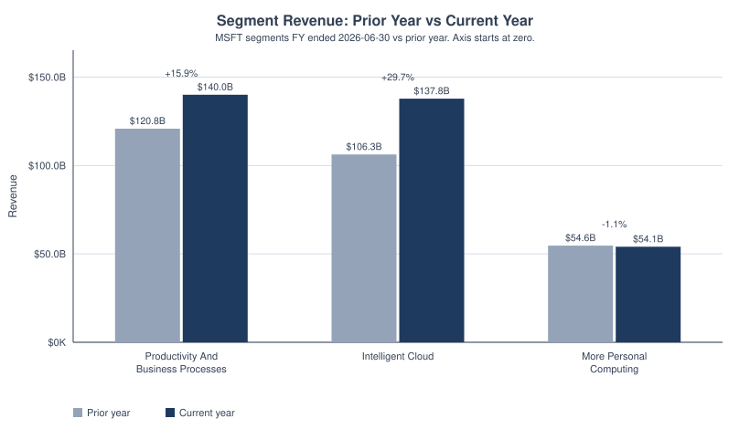

# Budget Variance Analyzer

[](https://github.com/builtby-hari/BudgetVarianceAnalyzer/actions/workflows/tests.yml)  [](LICENSE)

The monthly budget-vs-actual close, as one command. Give it a budget file and an actuals file. It shows where spend is off, which gaps are big enough to need an explanation, and where the year lands at the current pace.

On the sample data (synthetic FY2026, through September), total spend is **$547.7K (1.9%) over budget**, and one line, Technology contractors, is $454.5K over on its own.

<picture>
  <source media="(prefers-color-scheme: dark)" srcset="docs/heatmap-dark.svg">
  
</picture>

## What it does



Every output reads from the same variance engine, so the Excel pack, the HTML report and the charts always tie to the same numbers.

A few terms, in plain words:

- **Variance:** actual minus budget. For costs, over budget is unfavorable (U) and under is favorable (F). For revenue it flips.
- **Materiality:** the rule for which gaps need a written explanation. Here a line has to be off by more than $25K and more than 10%. Both, not either.
- **Run-rate:** the full-year estimate if the rest of the year looks like the last three months.
- **Bridge:** a waterfall chart that walks from the budget number to the actual number one driver at a time.
- **Price, volume, mix (PVM):** splits a revenue gap into three causes: charging different prices, selling a different number of units, and selling a different blend of products.

## The result (synthetic FY2026 data, through September)

- Total spend is **$547.7K (1.9%) over** the year-to-date budget. Technology accounts for $687K of it.
- **Technology / Contractors** is $454.5K (21.6%) over. That clears both materiality tests, so it's flagged. At the last three months' pace it finishes about **$650K over** the full-year budget.
- A big line can stay unflagged. Operations salaries are $201K under budget, but that's only 5.2%, so they don't need an explanation.
- Price, volume and mix example: revenue beat budget by $58.3K. Higher prices added $46.8K and a richer product mix added $62.1K, which more than covered $50.6K lost on 1,750 fewer units.

The ten biggest gaps, with the material ones starred:

<picture>
  <source media="(prefers-color-scheme: dark)" srcset="docs/flagged-dark.svg">
  
</picture>

Where the full year lands if the forecast holds, walked from the budget one driver at a time:

<picture>
  <source media="(prefers-color-scheme: dark)" srcset="docs/forecast-outlook-dark.svg">
  
</picture>

The same idea for operating income, on a second sample file that has revenue lines (full year):

<picture>
  <source media="(prefers-color-scheme: dark)" srcset="docs/bridge-dark.svg">
  
</picture>

And what the terminal prints:

<picture>
  <source media="(prefers-color-scheme: dark)" srcset="docs/sample-output-dark.svg">
  
</picture>

## Real companies (SEC filings)

The same engine also runs on public companies. They do not publish budgets, so the comparison is against something they do publish.



Try it on the bundled Home Depot data, no network needed:

```bash
python3 cli.py sec --ticker HD --facts tests/fixtures/hd_companyfacts.json --mode yoy
```

Home Depot's fiscal 2025 sales rose $5.2B, but operating income fell $636M. Higher cost of sales ($3.6B) and SG&A ($2.0B) took more than the extra sales brought in.

<picture>
  <source media="(prefers-color-scheme: dark)" srcset="docs/sec-hd-bridge-dark.svg">
  
</picture>

Segments read straight from a 10-K. Microsoft's Intelligent Cloud grew 29.7% and More Personal Computing slipped 1.1%:

<picture>
  <source media="(prefers-color-scheme: dark)" srcset="docs/sec-msft-segments-dark.svg">
  
</picture>

Every number lists its filing, period, accession number and XBRL tag. Details, flags and limits: [docs/public-companies.md](docs/public-companies.md).

## Run it

Try it in one line. No installs, it runs on the sample data:

```bash
git clone https://github.com/builtby-hari/BudgetVarianceAnalyzer.git && cd BudgetVarianceAnalyzer && python3 cli.py --through 2026-09
```

Python 3.9+. No installs needed for the core tool.

```bash
python3 cli.py --through 2026-09                     # the summary above
python3 cli.py --through 2026-09 --xlsx output/pack.xlsx   # Excel with live formulas
python3 cli.py --forecast data/forecast.csv          # rolling forecast, accuracy and commentary
python3 cli.py --pvm data/pvm_example.csv            # price / volume / mix
python3 -m unittest discover                         # tests
```

`--fail-on-material` exits with status 1 if any line is material, so it can gate a close checklist.

`python3 -m bva.charts` redraws every chart on this page from the sample data. It needs no installs.

## What I fixed along the way

- Closed months with no actuals used to count as zero spend, which made lines look under budget. The tool now stops and names the missing month.
- CSVs saved from Excel carry a hidden byte-order mark that broke the header match. They now load cleanly.

The sample data in `data/` is synthetic. The public-company fixtures in `tests/fixtures` are trimmed copies of real SEC filings (Home Depot and Microsoft). Full concepts, formulas and methods: [docs/reference.md](docs/reference.md).
