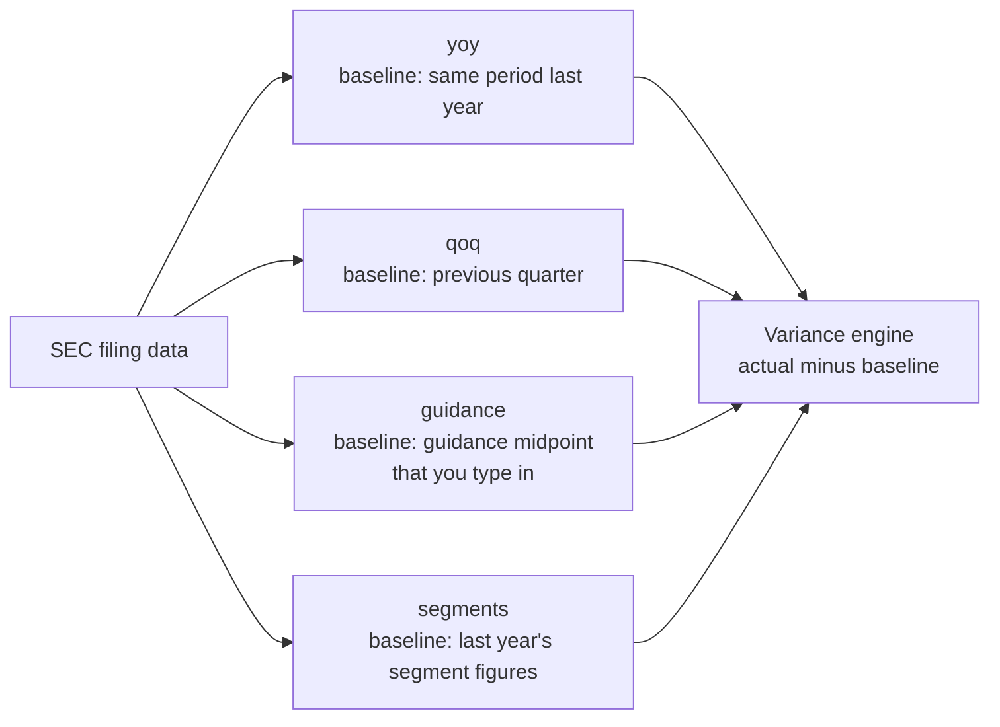
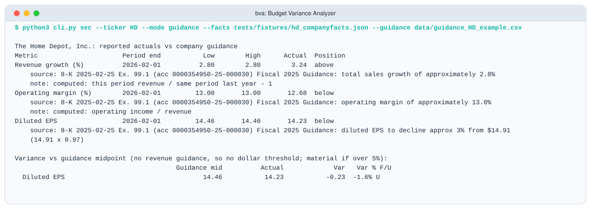
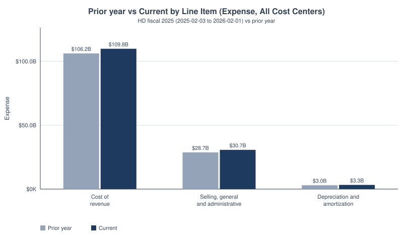
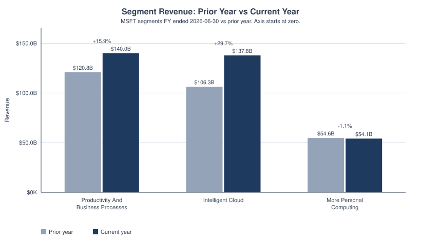

# Public companies

The same variance engine, run on real companies with data from SEC filings. Public companies do not publish internal budgets, so the "budget" column is something they do publish.

| Mode | "Budget" is | "Actual" is |
|---|---|---|
| `yoy` | the same period last year | this period (annual 10-K, quarter or year to date from a 10-Q) |
| `qoq` | the previous quarter | the latest quarter |
| `guidance` | the midpoint of guidance you typed into a CSV | the reported figure from XBRL |
| `segments` | last year's figure for each segment | this year's figure, from the 10-K itself |



Revenue lines are favorable when above the baseline and expenses are favorable when below it, as everywhere else in the tool.

## Run it

```bash
python3 cli.py sec --ticker HD --mode yoy                    # fetches SEC data
python3 cli.py sec --ticker HD --mode yoy --period ytd       # latest 10-Q year to date vs last year
python3 cli.py sec --ticker HD --mode yoy --period q         # latest quarter vs the same quarter last year
python3 cli.py sec --ticker HD --mode qoq                    # latest quarter vs the one before
python3 cli.py sec --ticker HD --mode guidance --guidance data/guidance_HD_example.csv
python3 cli.py sec --mode segments --instance 10k.htm --accession 0001193125-26-323660
```

Offline: save the files once and pass them in. `--facts companyfacts.json` replaces the fetch, `--tickers company_tickers.json` replaces the ticker lookup, and `--save-facts file.json` keeps what was fetched. `--period-end YYYY-MM-DD` picks an older period. `--csv`, `--xlsx`, `--html` and `--charts` work as in the main tool.

Fetching uses the SEC's public API with the User-Agent `BudgetVarianceAnalyzer research tool admin@example.com`. Replace that with your own contact details (in `bva/secdata.py`) if you run it regularly; the SEC asks for real ones.

## Where every number comes from

Each figure carries its form, period, accession number and XBRL tag.

- The terminal prints a Sources block.
- `--csv out.csv` also writes `out.sources.csv` (use `--sources-csv` to pick the name).
- The HTML report ends with a Sources table.
- A derived line lists every filed figure it was built from. Examples: a fourth quarter is the 10-K year minus the nine-month figure from the 10-Q, and "other operating expenses" is total operating expenses minus the itemized lines.

When the same period appears in several filings, the most recently filed one is used, since it holds any restatement. That is why last year's column often cites this year's 10-K.

## How the income statement maps

- Revenue is a revenue line. Cost of revenue, SG&A (or selling and marketing plus G&A), R&D and depreciation and amortization (when it is its own income statement line) are expense lines.
- Revenue: when a company files more than one revenue tag for the same period (for example contract revenue and total revenues), the larger current-period total is used and a warning names both figures. A subset tag never silently understates revenue.
- The lines are checked against reported operating income. If they do not reconcile, a warning says so, and the terminal shows the reported operating income and the unreconciled gap instead of an engine figure. Banks, insurers and unusual layouts may need a manual look.
- Interest, income before taxes, taxes, net income and EPS sit in a memo table under the engine output, so the engine's operating income is the reported operating income.
- Nothing is spread across months. Both sides sit in the period's end month, so monthly charts show one bar, and no full-year projection is made (a filed period is already complete). Titles and notes carry the company's own fiscal label from the filing's fy and fp fields, for example "[fiscal 2025]" for Home Depot's year ended 2026-02-01. The fiscal year is read as the earliest fy across the filings that report that exact period, because fy is the year of the filing and comparatives carry a later one. If the fields are missing the label is left out and the dates stand alone.
- Materiality defaults to 0.5% of baseline revenue and 5%. Override with `--amount-threshold` and `--pct-threshold`.

## Guidance

Guidance is not machine readable, so you type it in. See `data/guidance_template.csv` for the columns and `data/guidance_HD_example.csv` for a real example, with the press release text cited in the file. The comparison table shows whether the actual landed below, within or above the guided range. A range is inclusive. A single-number guide counts as within when the actual is inside a small tolerance of it: 0.5% of the number for dollars and EPS, 0.1 percentage point for percent metrics (`POINT_TOLERANCE` in `bva/guidance.py`).

<picture>
  <source media="(prefers-color-scheme: dark)" srcset="sec-hd-guidance-dark.svg">
  
</picture>

With no revenue guidance there is no dollar materiality threshold, so only the percent test applies. Percent metrics (`revenue_growth_pct`, `operating_margin_pct`) are computed from XBRL and shown in the table only. The example is the initial guidance; later updates are not included.

## Charts

Run `python3 -m bva.charts` to redraw these from the bundled fixtures. `--charts DIR` on a `sec` run writes the same kinds of charts for any company (the bridge, plus a segment chart in `segments` mode).

<picture>
  <source media="(prefers-color-scheme: dark)" srcset="sec-hd-line-items-dark.svg">
  
</picture>

## Segments

The companyfacts API has no segment data, so `--mode segments` reads a saved 10-K inline XBRL file (the `.htm` you download from EDGAR, or an XBRL instance `.xml`). It reads contexts that have exactly one member on the segment axis (`--axis segment`, `product` or `geography`) and takes revenue and operating income for the latest year and the one before.

- Each segment becomes a cost center. Revenue is a revenue line. Where operating income is tagged, an "Operating costs (implied)" expense line (revenue minus operating income) is added so the cost-center views, heatmap and bridge work.
- The accession number is not inside the file, so pass `--accession`.
- It flags rather than guesses: generic member names (for example Home Depot's "Primary Segment" and "All Other Segments"), segments that do not add up to the consolidated figure, duplicate facts that disagree, contexts with more than one axis (skipped and counted), segments with revenue but no operating income, and a missing axis (it lists the cuts it did find instead of switching on its own).
- Member names are read from the tag, for example `msft:IntelligentCloudMember` becomes "Intelligent Cloud". Display labels live in a separate file this tool does not read.

<picture>
  <source media="(prefers-color-scheme: dark)" srcset="sec-msft-segments-dark.svg">
  
</picture>

## Limits

- XBRL tagging varies by company. Lines that cannot be tied to filed figures for both periods are left out and listed in the warnings.
- Quarterly numbers come from 10-Q facts. A fourth quarter exists only when the 10-K and the nine-month figure are both there.
- A 52 or 53 week year is compared to the prior year as filed, with no adjustment for the extra week.
- Non-GAAP figures (adjusted operating margin and the like) are not in XBRL and are not covered.
- Test fixtures in `tests/fixtures` are trimmed copies of real SEC data for Home Depot and Microsoft.
