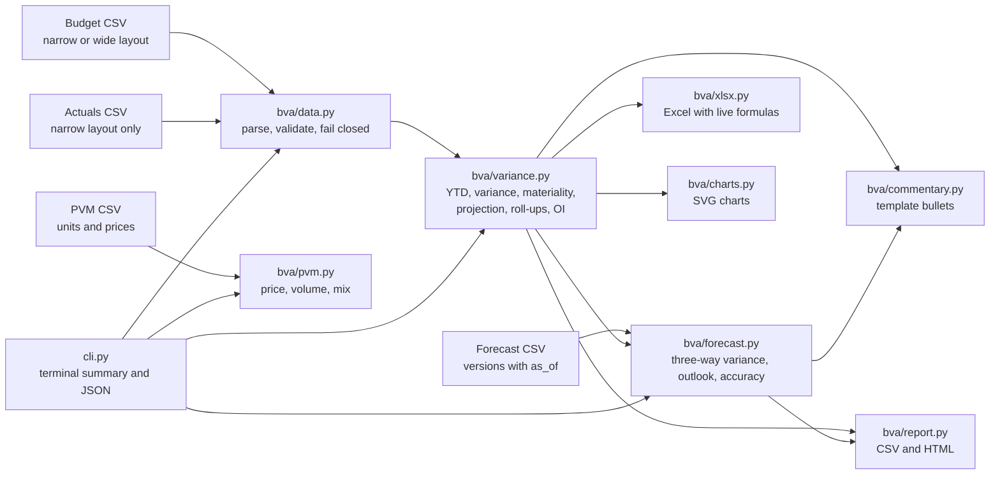
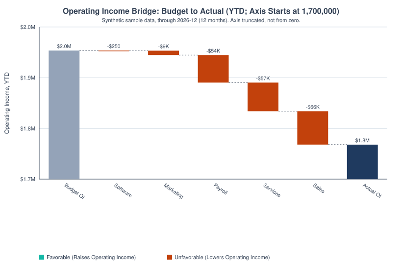
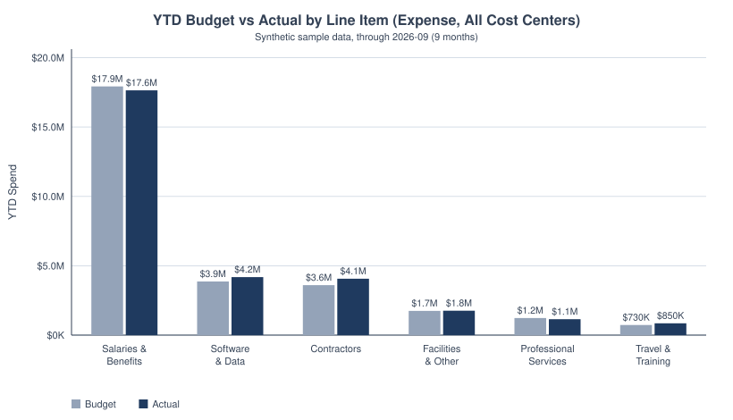
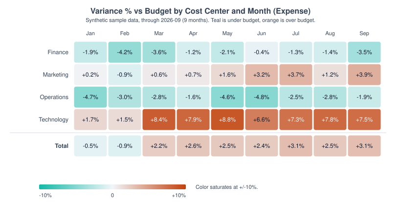
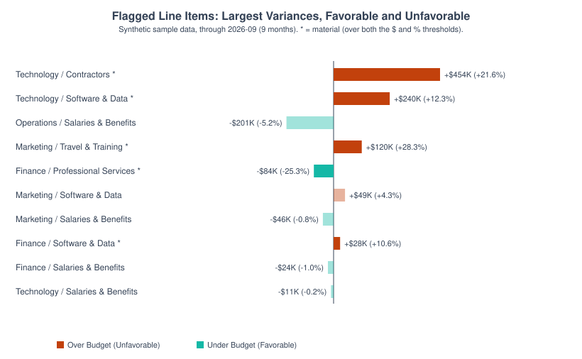
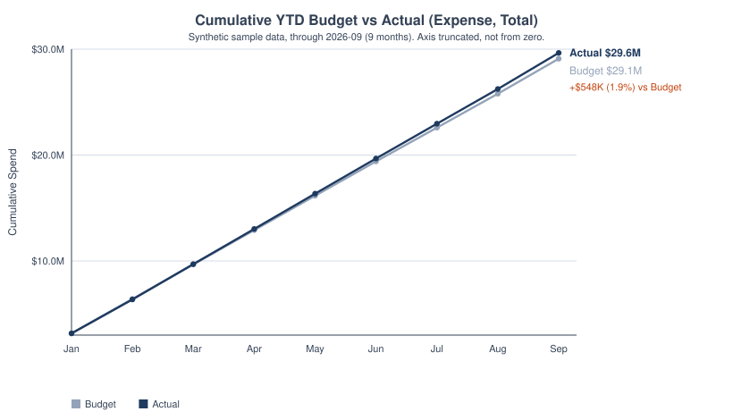

# Budget Variance Analyzer: full reference

The short project overview is in the [README](../README.md). This page keeps the full detail: concepts and formulas, architecture, the worked example, methodology and validation.

> **Illustrative results only.** Every number in this README comes from the synthetic sample data in `data/`, which is invented. It is not any company's financials.

## 1. Executive Summary

Every month, a finance team has to compare what it planned to spend and earn with what actually happened, decide which gaps are big enough to explain, and write those explanations. The Budget Variance Analyzer does that comparison from two CSV files (budget and actuals) in one command. It works out the dollar and percent gap for each cost center and account line, marks each as favorable or unfavorable, flags the ones big enough to matter, ranks the biggest drivers, projects the full year, and bridges operating income from budget to actual. It also drafts plain-English commentary, and it can add a rolling forecast, a revenue price/volume/mix split and an Excel workbook with live formulas. The core uses only the Python standard library, and each rule (materiality, sign convention, projection method) is written down in code and tested, so an analyst can check the output rather than trust it.

## 2. Key Concepts

**Variance and favorable or unfavorable.** A *variance* is the gap between actual and budget. It is a plain subtraction, but the sign has to mean something: for a cost, spending above budget hurts profit, and for revenue, sales above budget help it. The tool stores every variance as actual minus budget, then labels it *favorable* (F, it helps operating income) or *unfavorable* (U, it hurts), with a half-cent tolerance so that rounding noise shows as on budget.

$$\text{Variance} = A - B, \qquad \text{Variance \%} = \frac{A - B}{|B|}$$

where $A$ is year-to-date (YTD) actual and $B$ is YTD budget. For an expense line, a positive variance is unfavorable. For a revenue line, a positive variance is favorable.

**Materiality.** *Materiality* is the threshold for what is big enough to deserve an explanation. A tiny percent swing on a large line can be noise, and a large percent swing on a tiny line rarely matters. Here a line is flagged only when it breaches **both** a dollar test and a percent test, so it has to be big in dollars and in relative terms. Both thresholds are set on the command line.

$$\text{Material} \iff |A - B| > \$25{,}000 \ \text{and}\ \frac{|A - B|}{|B|} > 10\%$$

**Run-rate projection.** A *run-rate* assumes recent months keep their current pace. It is the simplest way to estimate the full year: take YTD actual, then add the average of the last few closed months for each month still open. It is a sanity check against budget, not a forecast, because it ignores seasonality and known one-off items. The tool also offers a *budget-remaining* method (YTD actual plus the budget for open months), which assumes the rest of the year lands on plan.

$$FY_{\text{proj}} = A + m \cdot \bar{a}_k, \qquad \bar{a}_k = \frac{1}{k}\sum_{t=n-k+1}^{n} a_t$$

where $n$ is the number of closed months, $m = 12 - n$ is the number of open months, and $\bar{a}_k$ is the average of the last $k$ closed months (default $k = 3$).

**Operating income and its bridge.** *Operating income* (OI) is what is left from revenue after the costs of running the business, before interest and tax. An *operating income bridge* is a step chart that starts at budget OI, adds or subtracts each category's favorable or unfavorable effect, and ends at actual OI, so the reader sees which categories moved the total. Each step is a line's favorable variance summed by category, so the steps add up exactly to the change in OI.

$$OI = \sum \text{Revenue} - \sum \text{Expense}, \qquad \Delta OI = OI_A - OI_B = \sum_{\ell} \text{Favorable}_\ell$$

**Price, volume and mix (revenue).** This splits a revenue variance into three causes. *Price* is what the same units earned at a different price. *Volume* is the change in total units, valued at the average budget price. *Mix* is the change in which products were sold, holding total units fixed. Together they add up exactly to actual revenue minus budget revenue.

$$\text{Price} = \sum (AP - BP)\cdot AQ, \quad \text{Volume} = (\textstyle\sum AQ - \sum BQ)\cdot\frac{\sum BQ\cdot BP}{\sum BQ}, \quad \text{Mix} = \sum \Big(AQ - \textstyle\sum AQ\cdot\frac{BQ}{\sum BQ}\Big)\cdot BP$$

Here $BQ, BP$ are budget quantity and price, and $AQ, AP$ are actual quantity and price, per product.

**Forecast accuracy (MAPE and bias).** When a rolling forecast is given, each closed month's earlier forecast is scored against the actual. *MAPE* (mean absolute percent error) is the average size of the miss, ignoring direction. *Bias* is the average direction of the miss: positive means the forecast ran high. The tool pools the error across lines weighted by size (wMAPE), so a $5 line cannot swamp a $5M line.

$$\text{MAPE} = \frac{1}{N}\sum_t \frac{|A_t - F_t|}{|A_t|}, \qquad \text{wMAPE} = \frac{\sum |A_t - F_t|}{\sum |A_t|}, \qquad \text{Bias} = \sum (F_t - A_t)$$

## 3. Architecture



Inputs go through one loader, which rejects bad rows rather than guessing. The variance module is the single source of truth; the forecast, commentary, report, Excel and chart modules all read its output, so every view reconciles to the same numbers.

## 4. Worked Example

**Line:** Technology / Contractors, FY2026, through September (nine closed months). Source: `data/budget.csv` and `data/actuals.csv` (synthetic).

**Inputs**

| Input | Value |
|---|---|
| Monthly budget, Jan to Dec | 233,300 each month (FY budget 2,799,600) |
| Actuals, Jan to Sep | 234,700; 235,800; 292,600; 297,200; 294,400; 304,500; 292,300; 299,300; 303,400 |
| Materiality | over $25,000 **and** over 10% |
| Projection | run-rate, average of the last 3 closed months |

**Steps**

1. YTD budget $B$ = 9 × 233,300 = **2,099,700**
2. YTD actual $A$ = sum of nine months = **2,554,200**
3. Variance = 2,554,200 − 2,099,700 = **+454,500**. Expense, so over budget and unfavorable (U).
4. Variance % = 454,500 / 2,099,700 = **21.6%**
5. Material? 454,500 > 25,000 (yes) and 21.6% > 10% (yes). **Material.**
6. Run-rate average of Jul to Sep = (292,300 + 299,300 + 303,400) / 3 = **298,333**
7. Full-year projection = 2,554,200 + 3 × 298,333 = **3,449,200**
8. Projected variance = 3,449,200 − 2,799,600 = **+649,600** (+23.2% of FY budget)

**Outputs** (from `python3 cli.py --through 2026-09`)

```text
Top 5 drivers (YTD, by absolute $ variance):
 1. Technology / Contractors              +454,500 +21.6% U  MATERIAL
```

The CSV row for the same line has `variance` 454500.00, `variance_pct` 0.2165, `material` Y, and `projected_variance` 649600.00.

**Interpretation:** Contractor spend is $454.5K (21.6%) over the nine-month budget, and at the recent pace it finishes about $650K over the full-year budget, so the owner needs to explain it before the pack goes out.

### Second example: price, volume and mix

Input: `data/pvm_example.csv`. These are illustrative numbers taken from a public tutorial, not company data.

| Product | Budget qty × price | Actual qty × price |
|---|---|---|
| Garden Chairs | 5,000 × $30 | 4,800 × $35 |
| Dining Tables | 4,000 × $70 | 4,550 × $75 |
| Decorative Plants | 9,000 × $10 | 6,900 × $10 |

Steps: budget revenue 520,000; flexed revenue (actual units at budget prices) 531,500; actual revenue 578,250. Price = 578,250 − 531,500 = **+46,750**. Volume = (16,250 − 18,000) × (520,000 / 18,000) = **−50,555.56**. Mix = 531,500 − 16,250 × 28.889 = **+62,055.56**. Check: 46,750 − 50,555.56 + 62,055.56 = 58,250 = 578,250 − 520,000.

**Output** (from `python3 cli.py --pvm data/pvm_example.csv`): Price 46,750.00, Volume -50,555.56, Mix 62,055.56.

**Interpretation:** Revenue beat budget by $58.3K. Higher prices added $46.8K, and a shift toward the higher-priced tables added $62.1K, which more than offset the $50.6K lost from selling 1,750 fewer units in total.

## 5. Visuals

All five charts are redrawn by `python3 -m bva.charts` from the synthetic sample data, with no installs. `plots_mpl.py` draws matplotlib PNG versions of the same five charts into `docs/figures/` if you want them. Each chart states its units and its synthetic-data assumption in the title.

<picture>
  <source media="(prefers-color-scheme: dark)" srcset="bridge-dark.svg">
  
</picture>

*Figure 1. Operating income bridge, budget to actual, YTD through 2026-12, wide synthetic sample. Y-axis in $ millions, truncated (does not start at zero). Steps are in $ thousands, one per category, and sum to the favorable variance of −$185,654. Assumption: revenue and expense lines in `data/sample_wide.csv` are invented.*

<picture>
  <source media="(prefers-color-scheme: dark)" srcset="line-items-dark.svg">
  
</picture>

*Figure 2. YTD budget and actual by expense line item, through 2026-09, summed across cost centers. Y-axis in $ millions. Assumption: `data/budget.csv` and `data/actuals.csv` are invented.*

<picture>
  <source media="(prefers-color-scheme: dark)" srcset="heatmap-dark.svg">
  
</picture>

*Figure 3. Materiality heatmap of variance percent to budget by cost center and month, through 2026-09. Color is symmetric around 0; orange is over budget (unfavorable), teal is under budget (favorable). Each cell is one month's variance divided by that month's budget. Assumption: synthetic data.*

<picture>
  <source media="(prefers-color-scheme: dark)" srcset="flagged-dark.svg">
  
</picture>

*Figure 4. Ten largest YTD variances by line, in $ thousands, through 2026-09. Positive is over budget. An asterisk marks lines that breach both materiality tests. Assumption: synthetic data.*

<picture>
  <source media="(prefers-color-scheme: dark)" srcset="cumulative-dark.svg">
  
</picture>

*Figure 5. Cumulative YTD budget and actual, total expense, through 2026-09. Y-axis in $ millions, truncated. The annotation shows the YTD gap in $ thousands. Assumption: synthetic data.*

## 6. Methodology and Assumptions

**Sign convention.** Every variance is actual minus budget. The F/U label tells you whether that helps profit.

| Line type | Positive variance means | Favorable when |
|---|---|---|
| Expense | Spent more than budget | Variance is negative |
| Revenue | Earned more than budget | Variance is positive |

**Assumptions**

- Fiscal year is the calendar year of the last closed month.
- YTD covers only closed months (months up to `--through`, default: the latest month in the actuals file). Open months use budget or forecast only.
- Budget and actuals are summed per cost center and category. Duplicate rows are added together, as with multiple ledger postings.
- A closed month with no actuals for a line is an **error** (fail closed), because a late feed would otherwise look like a favorable variance. `--allow-missing-actuals` counts it as $0 and flags it.
- A zero-budget line has no percent, so only the dollar test applies to it.
- Cost-center and total rows sum expense lines only. Revenue appears as lines, in the bridge and in the operating income total.
- Operating income variance % divides by the gross budget (sum of absolute line budgets), because dividing by a net figure that mixes revenue and expense has no meaning.

**Limitations**

- The run-rate is naive. It ignores seasonality, one-off items, hiring plans and contract step-ups. It is a check against budget, not a forecast.
- The materiality test is one fixed rule for every line. Real policies often vary by account or cost center.
- Commentary is template text. It states what moved, not why. The cost-center owner supplies the cause.
- Price, volume and mix covers revenue only, uses a separate input file, and does not split expense (no flexing of costs).
- No GL integration, no multi-currency, no accruals or reclass logic.
- The forecast file uses the narrow layout only.

## 7. Validation

- **Hand checks.** The worked example in section 4 was recomputed by hand from the raw CSV rows. The CLI output and the CSV row match. The price/volume/mix example was checked with the formulas written out, and the components sum exactly to the revenue variance.
- **Reconciliation tests.** The test suite checks that the operating income bridge steps add up to the favorable variance, that cost-center rows add up to the total, that price + volume + mix equals actual minus budget, and that the Excel export's cached values agree with the Python results. The tests check the formula text in each cell; they do not recalculate the workbook in a spreadsheet engine.
- **Reference.** The variance and price/volume/mix definitions follow the standard managerial accounting treatment in Horngren, Datar and Rajan, *Cost Accounting* (sales variance and sales-mix chapters). The forecast accuracy measures follow Hyndman and Athanasopoulos, *Forecasting: Principles and Practice* (accuracy measures). Where sources differ, the README and module docstrings say which definition is used.
- **Test command.** From the repository root, using only the standard library:

```bash
python3 -m unittest discover -v
```

- **Not yet validated.** The tool has been run only on synthetic data. It has not been compared with a company ledger or a production close.

## 8. Quick Start

Requirements: Python 3.9 or newer. The core needs no installs. The figures need matplotlib: `python3 -m pip install -r requirements-extra.txt`.

Reproduce the worked example (section 4) and regenerate the figures (section 5) with one command line:

```bash
python3 cli.py --through 2026-09 --csv output/worked_example.csv && python3 plots_mpl.py
```

Other useful commands:

```bash
python3 cli.py --budget data/sample_wide.csv                    # wide layout with revenue and expense lines
python3 cli.py --forecast data/forecast.csv                     # rolling forecast, accuracy and commentary drafts
python3 cli.py --json                                           # machine-readable analysis
python3 cli.py --fail-on-material                               # exit status 1 if any line is material (for CI)
python3 cli.py --pvm data/pvm_example.csv                       # revenue price, volume and mix
python3 cli.py --xlsx output/variance.xlsx                      # Excel with live formulas
```

Run `python3 cli.py -h` for every option.
